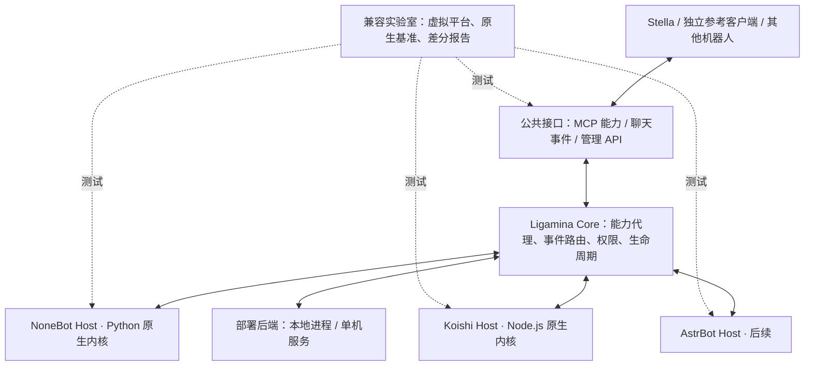

# Ligamina 初步计划

日期：2026-10-09。状态：初步方案；尚未实施和验收。

用户已核实通过本初步计划。后续范围与工程任务见 [v0.1 MVP 清单](2026-10-09-ligamina-mvp-checklist.md)和[工程执行计划](2026-10-09-ligamina-engineering-plan.md)；本文件保留初步规划内容用于追溯。

依据：[原始讨论](https://chatgpt.com/share/6ac8b4f4-4ad8-83e9-b269-90629f1c7979)。用户意图与本次取舍见[讨论结论](2026-10-09-ligamina-discussion-decisions.md)。本文件的接口名、目录名、样本数量及验收门槛均为规划建议。

## 1. 项目定位与第一阶段范围

**Ligamina 是个人部署优先的插件联邦运行时，并配套建设自动化兼容性实验室。** 它让已有生态的插件留在原生宿主中运行，通过公共接口向机器人和 Agent 提供能力、事件处理与运行状态。

Stella 是首个真实客户端，但 Ligamina 的核心、宿主与测试系统不依赖 Stella 的路由、人格、记忆或内部注册表。一个不使用 Stella、也不调用模型的参考客户端必须能够完成相同的接入流程。

第一阶段重点：

1. Windows x64 个人部署，宿主按需安装、启动和停止。
2. NoneBot（Python）与 Koishi（Node.js）两套原生宿主，先验证简单命令和函数能力，再扩展服务与复杂插件。
3. 自动化原生基准、联邦差分测试、故障恢复测试和版本化报告。
4. 同一核心与适配器在单机 Linux 服务/Compose 中完成关键场景，尽早检验部署抽象。
5. 两宿主与实验室形成闭环后，引入 AstrBot 宿主和 Stella 集成。

后续再考虑多机器调度、集群、多租户、插件全量深测和任意跨生态对象互通。兼容结果始终绑定插件版本、框架版本、平台配置、环境与测试范围。

## 2. 总体结构与职责



| 组件 | 负责什么 | 边界 |
|---|---|---|
| Core / Capability Broker | 能力发现、授权、路由、依赖状态、运行记录 | 插件业务代码在 Host 中执行 |
| Host Adapter | 原生插件加载、事件转换、服务桥接、资源释放 | 保留原生框架与同生态依赖机制 |
| Client Adapter | 接入能力、输入事件、执行授权的平台操作 | Stella 对接自身注册表与发送网关 |
| Deployment Backend | 本地进程启停，或连接外部托管的 Host | Core 不写死进程创建或 Docker 管理方式 |
| Compatibility Lab | 环境构建、基准、事件夹具、行为断言、故障归因 | 独立开发工具，用户运行包不强制包含 |
| Catalog / Report Store | 同步上游元数据、记录精确测试条件与证据 | 复用上游分发，初期不重新分发插件包 |

**推荐 Rust 作为交付核心，Python/TypeScript 实现各自宿主。** 这是沿用讨论的技术建议；先在 P0 用最小跨语言通信与打包实验确认，随后冻结工具链，避免无依据地追加第二套核心。

## 3. 优先定义的契约

### 3.1 三种对外接口

- **能力接口：** 用 MCP 暴露适合函数调用的能力。只导出有明确参数、结果与权限的接口；普通消息监听器维持事件语义。参考当前[官方 MCP 规范](https://modelcontextprotocol.io/specification/2026-07-28)，实现前固定规范与 SDK 版本。
- **事件与平台接口：** 评估 Satori/OneBot 的现成模型，形成一个最小聊天配置档。保留结构化消息、回复关系、账号、发送者、会话及平台扩展；针对特定适配器的插件，需要匹配其原生事件类型与 API，不能只提供一个泛化 Event。
- **管理接口：** 描述宿主握手、插件启停、状态、依赖与能力变化。与 MCP 工具调用分开演进，并制定版本不匹配、权限拒绝与不支持能力的错误语义。

内部 Core–Host 使用版本化异步 RPC。P0 优先验证本机 stdio 的简单原型，stdout 专用于协议、日志走 stderr；本地正式传输可评估 Named Pipe/Unix Socket，服务器传输独立适配。传输方式不进入插件业务契约。

### 3.2 生命周期与资源归属

建议插件状态：`installed → starting → active → draining → stopped`，失败与依赖缺失分别进入 `failed`、`blocked`。能力仅在成功激活后公开；宿主失效后及时撤销或标记不可用。

资源记录至少包含 Host、插件实例、运行代次以及所属订阅、任务、能力注册和桥接服务。关闭时先停止新请求，再等待或取消在途任务，最后释放资源。无法可靠卸载的原生环境允许重建整个 Host，并明确告知同宿主插件会一起恢复。

第一版以停止并重建为可靠更新路径。候选版本验证、独占分发权切换和回滚可逐步加入；不要将任意插件的无损热替换设为首版默认承诺。

### 3.3 消息、副作用和身份

- 消息入口和输出网关有唯一所有者。接入 Stella 时由 Stella 提供授权的平台服务，Host 经桥接回复。
- 统一身份携带平台、账号、会话种类、会话 ID、发送者、原始事件 ID。授权上下文由可信入口提供，防止跨群、跨私聊、跨账号混用。
- 同一生态内部沿用原生命令优先级和阻断逻辑；跨生态先明确“观察订阅”与“可阻断处理”，采用确定性顺序和超时策略，避免默认并行广播产生重复回复。
- 请求包含请求 ID、实例与运行代次、截止时间、追踪 ID；有外部副作用的操作使用操作 ID 和持久化结果记录。出现发送后断连时返回结果未知，不盲目重发。
- 已发送消息、外部 API 修改等不能因卸载而自动撤销。资源回收、数据库事务和外部补偿分别报告。

### 3.4 跨宿主服务

仅桥接显式公开、有序列化契约的服务，不自动映射所有内部函数，也不从命令描述猜测工具参数。旧插件无需修改业务源码，必要映射由侧车描述或桥接扩展提供。

同生态跨插件依赖保留在宿主内部；跨生态调用经过 Broker，包含权限、版本、超时与调用链约束。PoC 使用测试插件或桥接服务证明互通，不据此宣称任意既有插件已自动互通。

## 4. 自动化兼容性实验室

采用“广度扫描 + 代表性深测 + 固定回归”，和 Host Adapter 同步推进。

| 层级 | 内容 | 能证明什么 |
|---|---|---|
| L0 元数据 | 来源、版本、哈希、许可证、依赖、平台要求 | 可发现与分类 |
| L1 安装 | 锁定依赖、独立环境、安装日志 | 在指定环境可安装 |
| L2 原生基准 | 原生宿主加载；有夹具时也运行原生行为场景 | 建立上游可运行的比较基准 |
| L3 联邦宿主 | 加载、注册、事件接入、停用与重建 | 管理和桥接基础可用 |
| L4 行为差分 | 相同事件与预期，比较回复、API 调用、顺序、权限与订阅 | 指定行为在联邦路径下保持一致 |
| L5 稳定性 | 重复启停、崩溃、断连、依赖消失、长时间运行 | 指定故障和时间窗口内的可靠性 |

两个环境固定插件包、依赖、框架、配置、随机种子和测试夹具，只改变联邦接入路径。原生行为本身不符合预期时，也不能因两边结果相同而判定行为正确。

虚拟聊天平台先提供群聊、私聊、提及、回复、结构化消息与发送回执，随后增加平台管理及异常场景。外部 AI、网络和时间服务通过 Mock 或约束断言实现可复现测试。真实 QQ/其他平台验收单列，模拟平台通过不替代真实接入。

优先复用 [NoneBug](https://github.com/nonebot/nonebug)、[Koishi 官方 Mock](https://koishi.chat/zh-CN/cookbook/practice/testing) 及 [NoneBot Registry](https://github.com/nonebot/registry) 的可用机制。上游记录保留测试时间与环境，作为选样依据，不替代 Ligamina 的行为测试。

初步样本安排：

- 每次提交：自制契约夹具和已知问题回归，覆盖命令、函数、定时任务、依赖和清理。
- 首批真实样本：NoneBot、Koishi 各 10–20 个，按功能、依赖和平台要求分层，共约 20–40 个；数量是起点建议。
- 深测：固定黄金样本，增加成对插件组合与命令冲突场景；重型插件由独立 Worker 调度。
- 广度扫描：后续按版本更新和失败风险轮换，保持取样名单、排除原因和预算可追溯。

结果逐层记录 `pass / fail / skipped / unknown`，另记原因：上游失败、环境不足、适配回归、未实现、未覆盖、策略拒绝。报告绑定插件哈希、框架/解释器版本、OS/架构、Ligamina 版本、夹具版本、日志和复现入口。

通过率只对声明范围计算，例如“原生行为基准通过且具备同一行为夹具的 N 个样本，有 M 个通过联邦行为测试”。加载成功不等于全部兼容，缺少行为夹具的插件不进入行为通过率分母。

第三方批量测试使用可销毁 Worker，安装与运行都纳入隔离；不给真实账号、个人目录和服务密钥。Windows 采用独立测试虚拟机，Linux 可采用受限容器/虚拟机。普通 venv 和子进程不作为恶意代码安全边界。

## 5. 分阶段实施与验收

| 阶段 | 主要交付 | 完成条件 |
|---|---|---|
| P0 契约与技术验证 | 术语、最小 JSON Schema、版本矩阵、Core/Host 边界、工具链与许可调研 | Rust/候选核心与 Python、Node 测试 Worker 完成双向调用、超时和取消；Windows 与 Linux 传输路径可行；选定版本与许可 |
| P1 实验室骨架 | 虚拟平台、原生基准 Runner、结果格式、可复现夹具 | 同一个 Echo/工具/任务夹具在两种执行路径可比较；故意注入的重复回复、权限错误与卸载残留能够被报告 |
| P2 NoneBot Host | 原生内核、首个明确适配器配置档、命令和能力桥接 | 群/私聊、回复、权限与依赖场景通过；无法卸载时重建有明确结果；首批真实插件完成原生/联邦报告 |
| P3 Koishi Host 与联邦闭环 | 原生 Koishi 内核、虚拟 Bot、命令/服务桥接、两宿主调用 | 独立客户端同时使用两生态；显式跨宿主服务可调用；终止一个 Host，另一个仍工作；恢复后无重复注册和回复 |
| P4 个人交付与服务器验证 | 按需 runtime bundle、本地管理 CLI、安装/更新/诊断、单机 Compose 模板 | 干净 Windows 环境不要求预装 Python/Node/Docker；Linux 使用同一版本适配器完成同一核心场景；更新失败可恢复 |
| P5 AstrBot 与 Stella 接入 | AstrBot Host、Stella Client Adapter、增量样本与真实平台验收 | 第三方客户端继续独立使用；Stella 的原有消息归属、权限与发送流程保持完整；实际消息回执与插件来源可追溯 |
| P6 持续兼容与报告发布 | Catalog 增量同步、轮换调度、兼容报告查询 | 更新检测能生成可复现任务；报告显示范围、时间和失败原因；新增生态可复用契约和实验室 |

依赖顺序：P0 → P1 → P2 → P3 → P4 → P5；Catalog 的纯元数据工作可从 P1 开始，持续流水线在版本和报告契约稳定后推进。P0/P3 先验证两种部署的关键路径，P4 再完成可交付包装。

先按里程碑验收，不承诺未经估算的开发日期。最早值得完成的纵向切片是：**独立客户端 → Core → NoneBot/Koishi → 虚拟平台 → 差分报告 → Host 崩溃与恢复**。

## 6. 第一版发布门槛

1. 独立参考客户端不依赖 Stella，可以发现能力、投递事件、调用公开服务、获得结果。
2. 首批样本具有精确版本与可复现报告；所有声明支持的核心契约场景通过，未知与未覆盖项明确展示。
3. 至少验证 100 次启停/重建循环及 24 小时代表性运行，零重复有效订阅、零旧代次继续发送；资源曲线无持续增长。数值是建议门槛，P0/P1 按硬件与样本校准。
4. 未启用生态的 Host 进程数为零；测量 Core 常驻内存、每个 Host 启动耗时/RSS、事件与调用 p95 延迟，基线测出后再冻结资源预算。
5. 干净 Windows 安装、停用、升级失败恢复与卸载均有证据；插件用户数据保留策略明确。
6. 单机 Linux 关键契约与 Windows 一致；仅模拟通过的功能和已真实平台验证的功能分别标记。
7. 权限拒绝、超时、取消、宿主失效、结果未知和不支持 API 均有稳定错误与诊断信息。

## 7. 建议仓库布局

```text
contracts/           公共 schema、协议和错误模型
core/                核心、能力代理与状态机
hosts/nonebot/       Python 原生宿主
hosts/koishi/        Node.js 原生宿主
hosts/astrbot/       后续宿主
clients/reference/  独立、非 AI 参考客户端
clients/stella/     后续 Stella 集成
lab/                虚拟平台、Runner、夹具与故障注入
catalog/            上游元数据与测试索引
deploy/             本地与单机服务包装
docs/               实施阶段契约、ADR 与使用说明
outputs/            当前初步规划交付
```

以上目录是未来布局，本次只初始化 Git 和规划文档。进入 P0 后再按选择的语言工具链创建最小工程。

## 8. 复用调研与待决事项

| 参考来源 | 下一步重点 | 本次证据边界 |
|---|---|---|
| [LangBot Plugin Runtime/SDK](https://github.com/langbot-app/langbot-plugin-sdk) | 进程通信、包管理、故障恢复与部署 | 已确认公开项目入口，具体复用需要源码与许可证审查 |
| [Aalis Koishi 兼容研究](https://github.com/AalisLabs/Aalis/blob/main/docs/roadmap/koishi-compat.md) | 原生内核选择、服务桥接难点 | 来源为原讨论，规模与 PoC 尚未重新核验 |
| [koishi-plugin-nonebot](https://github.com/nonebotjs/koishi-plugin-nonebot) | 单向复用机制及约束 | 来源为原讨论，先评估当前维护与技术边界 |
| [NapCatQQ Desktop](https://github.com/NapNeko/NapCatQQ-Desktop) | 多框架安装、配置与用户流程 | 来源为原讨论，管理互通不自动等于插件互通 |
| [NoneBot Adapter 文档](https://nonebot.dev/docs/advanced/adapter) | Adapter/Bot/Event/Message 的原生桥接位置 | 本次核对官方文档，具体平台配置档仍待选择 |
| [Koishi 测试文档](https://koishi.chat/zh-CN/cookbook/practice/testing) | Mock 会话与内存数据库测试 | 本次确认可用测试机制，联邦 Runner 尚未实现 |
| [AstrBot 官方仓库](https://github.com/AstrBotDevs/AstrBot) | 原生宿主边界、当前市场入口与元数据契约 | 已确认官方入口，版本与市场 schema 在接入前核验 |
| [Satori](https://satori.chat/) / [OneBot](https://onebot.dev/) | 事件、消息和平台操作的复用范围 | Satori 首页本次检索返回 404，具体规范入口与版本需重新定位 |

P0 需要产出决定：核心工具链；框架、解释器及 MCP SDK 版本；首个 NoneBot 平台适配器配置档；消息协议范围；本地/服务器传输；依赖隔离粒度；插件授权和操作系统限制；发行许可证与 runtime 分发许可。P1/P2 再确定黄金样本名单与资源预算。

同类项目用于降低工程风险，不以其介绍、插件数量或历史 PoC 直接推定 Ligamina 的兼容率。原论文思想主要用于资源所有权、依赖变化与生命周期设计；本次未重新获取论文附件，实际收益由上述实验验证。
